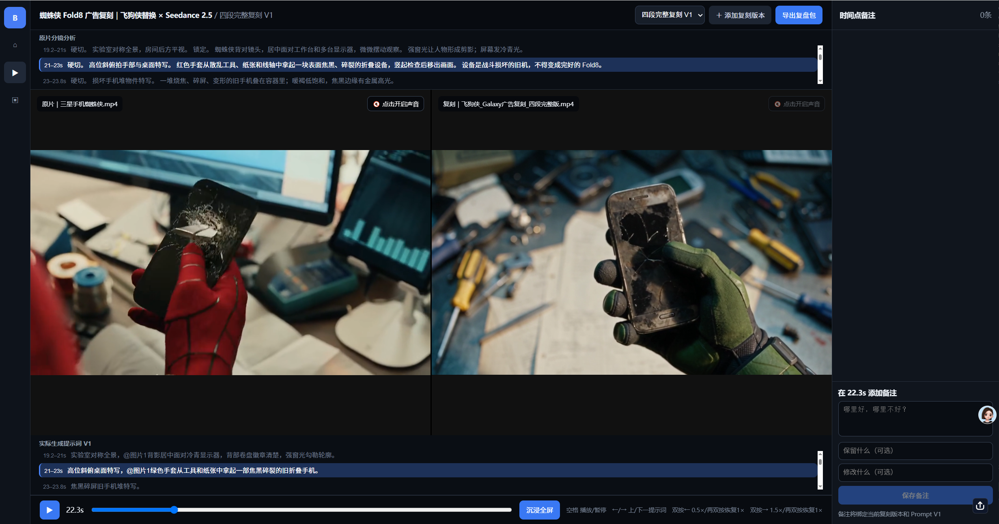
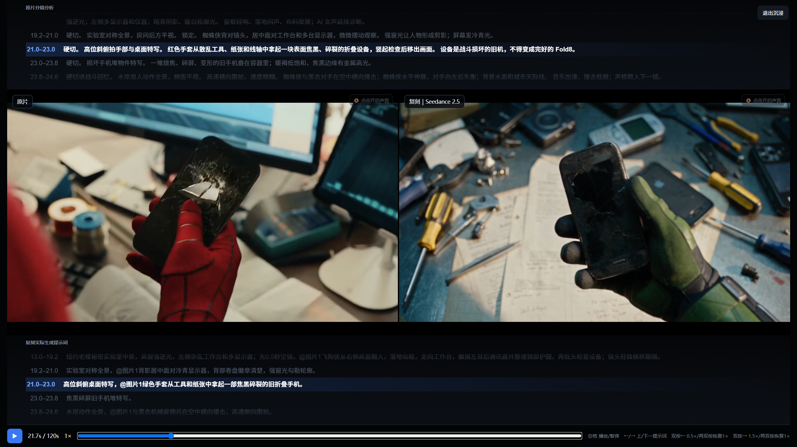

# 视频复刻复盘工作台

一个面向 AI 视频复刻流程的本地对照与复盘工具。它把**原片、复刻结果、两套分镜/提示词与时间点备注**放在同一条时间轴上，减少“播放—暂停—来回查提示词”的重复操作。

> 当前仓库为单用户本地 V1，示例项目使用《蜘蛛侠 Fold8》原片与飞狗侠复刻结果演示。

## 工作台：边看、边对比、边备注



- 原片与复刻视频左右同步播放，支持完整成片及四段独立结果切换。
- 上方展示**原片分镜分析**，下方展示**复刻实际生成提示词**，两套内容彼此独立。
- 提示词按时间戳自动滚动并高亮当前镜头，点击任意镜头即可跳转。
- 右侧备注自动绑定当前时间点、复刻版本与提示词版本，可分别记录“保留什么 / 修改什么”。
- 点击任一视频画面可独立开启或关闭该视频音频；两边可以同时开，也可以同时关闭。

## 沉浸模式：让视频成为主角



全屏后隐藏工作台干扰项，让原片和复刻画面居中展示。原片分镜与复刻提示词位于视频上下方，像歌词一样随播放自动滚动：当前句高亮，前后句弱化，点击句子可直接定位镜头。

### 快捷键

| 按键 | 操作 |
|---|---|
| `Space` | 播放 / 暂停 |
| `←` / `→` | 上一条 / 下一条提示词时间戳 |
| 双按 `←` | 0.5×；再次双按恢复 1× |
| 双按 `→` | 1.5×；再次双按恢复 1× |
| `Esc` | 退出沉浸模式 |

## 主要能力

- 原片 / 复刻同步播放与时间漂移校正
- 完整复刻与分段复刻切换
- 原片分镜、复刻实际提示词双轨展示
- 歌词式自动滚动、高亮和点击定位
- 独立音轨开关
- 时间点备注与版本关联
- Markdown / JSON 复盘包导出
- 可选绑定原 Hermes Session，便于后续把结构化备注交回原复刻上下文分析

## 本地启动

环境要求：Node.js 20+。

```bash
npm install
npm run dev
```

打开：<http://127.0.0.1:5173/>

## 验证

```bash
npm test
npm run build
```

## 数据与边界

- V1 项目结构与备注保存在浏览器 `localStorage`。
- 示例视频位于 `public/media/`，仅用于私有仓库演示与本地复盘。
- 当前不包含真实 Hermes Session API 写入；可导出复盘包后交回对应会话。
- 请勿将示例原片或复刻媒体公开分发；如改为公开仓库，应先移除 `public/media/` 下的演示视频。
